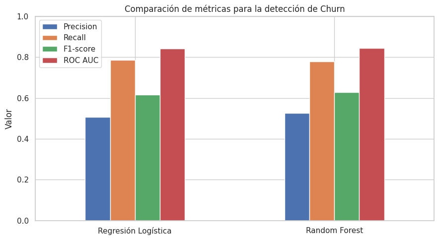
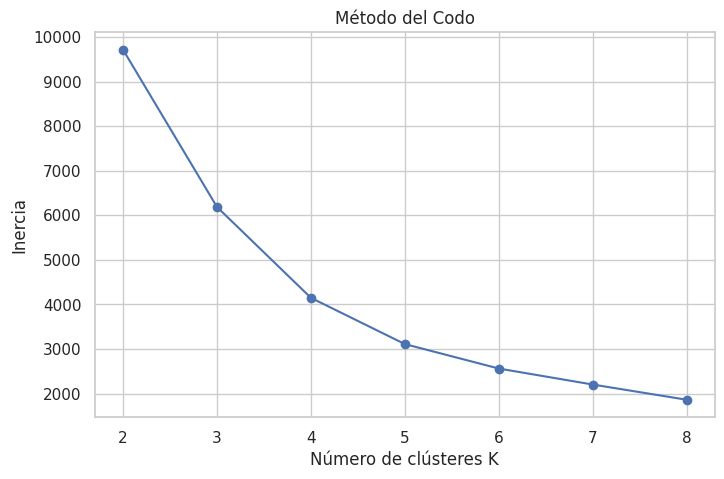
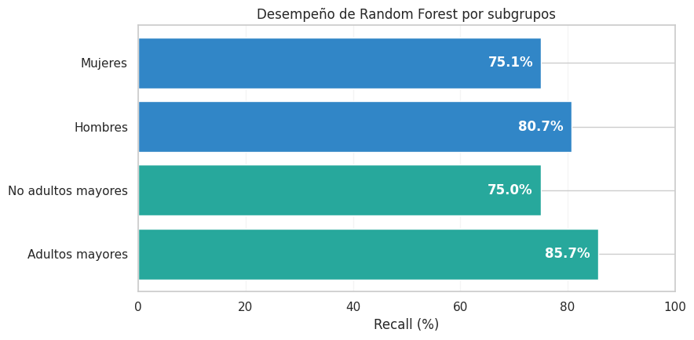

# TELCO | Predicción de abandono de clientes

**Evaluación Parcial N.º 2 | Machine Learning (MLY1101)**  
**Integrantes:** Alfredo Álvarez y Diego Bustamante  
**Caso:** Telco Customer Churn

## 1. Descripción del problema de negocio

Una empresa de telecomunicaciones necesita comprender por qué algunos clientes dejan de contratar sus servicios (*churn*). Identificar oportunamente a los clientes con mayor riesgo puede orientar campañas de retención, mejorar la experiencia y contribuir a reducir la pérdida de ingresos.

El proyecto analiza datos históricos de clientes para **predecir el abandono** y **encontrar segmentos con características compartidas**. Los resultados son una herramienta de apoyo a la decisión, no una prueba de causalidad ni un sistema comercial desplegado.

## 2. Objetivos del proyecto

**Objetivo general:** desarrollar y evaluar una solución de Machine Learning que permita detectar posibles abandonos de clientes y apoyar estrategias de retención en TELCO.

**Objetivos específicos:**

1. Analizar la calidad y distribución de los datos, identificando relaciones relevantes con `Churn`.
2. Preparar las variables para el modelamiento y mantener una partición independiente de prueba.
3. Entrenar y comparar dos algoritmos supervisados: **Regresión Logística** y **Random Forest**.
4. Evaluar las predicciones mediante métricas adecuadas para un problema de clasificación.
5. Identificar perfiles de clientes utilizando **K-Means** como técnica no supervisada.
6. Revisar posibles diferencias en el desempeño del modelo por género y condición de adulto mayor, y traducir los hallazgos en recomendaciones de negocio.

## 3. KPIs del proyecto

| Indicador | Definición | Resultado del conjunto de datos |
|---|---|---:|
| Tasa general de abandono | Clientes con `Churn = Yes` / total de clientes | **26,54 %** |
| Abandono en clientes nuevos | Clientes con abandono entre aquellos con 0 a 6 meses de antigüedad | **aprox. 52,9 %** |
| Abandono en contratos mensuales | Clientes con abandono dentro de `Contract = Month-to-month` | **aprox. 42,7 %** |
| Recall del modelo | Abandonos reales detectados / total de abandonos reales | Se calcula sobre el conjunto de prueba |

**Por qué se prioriza Recall:** en un caso de retención interesa evitar que clientes que efectivamente van a abandonar pasen inadvertidos. Sin embargo, también se consideran Precision, F1-score y ROC AUC para no seleccionar el modelo usando una sola métrica.

## 4. Fuente y descripción de los datos

El archivo `data/Telco_Customer_Churn_Dataset.csv` fue suministrado para el desarrollo del caso Telco Customer Churn en el contexto de la asignatura.

- **Registros:** 7.043 clientes.
- **Variables originales:** 21 columnas, incluida la variable objetivo `Churn`.
- **Tipos de información:** género, condición de adulto mayor (`SeniorCitizen`), servicios contratados, modalidad de contrato, antigüedad (`tenure`) y cargos mensuales y totales.
- **Variable objetivo:** `Churn` (`Yes` / `No`).
- **Nota:** `SeniorCitizen` es un indicador binario; el dataset no contiene edades exactas.

Antes de publicar una copia de los datos en un repositorio público, debe confirmarse que las condiciones de uso del dataset lo permitan. No se deben incorporar datos privados ni credenciales.

## 5. Preparación y análisis exploratorio (EDA)

Se revisaron tipos de datos, nulos, duplicados, distribuciones, valores atípicos, correlaciones y relaciones entre variables y abandono.

**Tratamiento aplicado:**

1. Conversión de `TotalCharges` a numérico y revisión de sus **11 valores faltantes**.
2. Imputación de esos valores con **0**, ya que corresponden a clientes con `tenure = 0`.
3. Revisión de perfiles repetidos. No se eliminaron automáticamente los registros que coincidían en sus atributos sin `customerID`, ya que podrían representar personas diferentes.
4. Exclusión de `customerID` como predictor y transformación de `Churn` a `0` y `1`.
5. Codificación de categorías mediante *one-hot encoding* y escalado de variables donde corresponde.
6. Partición estratificada **80 % entrenamiento / 20 % prueba**, con `random_state = 42`.

**Patrones identificados:** el abandono es notablemente mayor entre clientes recientes y quienes mantienen contratos mes a mes. Estos patrones se interpretan como asociaciones observadas, no como relaciones causales demostradas.

## 6. Metodología: CRISP-DM

| Etapa | Aplicación en TELCO |
|---|---|
| **Comprensión del negocio** | Definición del problema de abandono, objetivos y KPIs. |
| **Comprensión de los datos** | Análisis exploratorio, calidad de datos, patrones y relaciones relevantes. |
| **Preparación de los datos** | Conversión de tipos, nulos, selección de variables y codificación. |
| **Modelado** | Regresión Logística, Random Forest y segmentación K-Means. |
| **Evaluación** | Comparación de métricas, análisis de clústeres e interpretación de resultados. |
| **Despliegue** | Propuesta futura: alertas de riesgo y seguimiento del desempeño; **no implementado**. |

## 7. Modelos supervisados

La tarea se plantea como **clasificación binaria**: anticipar si un cliente abandona (`1`) o permanece (`0`).

| Modelo | Motivo de selección | Configuración relevante |
|---|---|---|
| **Regresión Logística** | Modelo de referencia, sencillo de interpretar. | `class_weight='balanced'`, `max_iter=2000`, escalado `StandardScaler`. |
| **Random Forest** | Permite representar relaciones no lineales y combinar muchos árboles. | 300 árboles, profundidad máxima 8, mínimo 3 muestras por hoja, `class_weight='balanced'`, `random_state=42`. |

Se comparan **Accuracy, Precision, Recall, F1-score, ROC AUC** y matrices de confusión. En el conjunto de prueba ambos modelos obtienen un Recall cercano al 78 %, y Random Forest presenta un F1-score y ROC AUC ligeramente superiores. Por ello se selecciona como alternativa con mejor equilibrio general, aunque la Regresión Logística tiene un Recall levemente mayor.



## 8. Técnica no supervisada: K-Means

Se aplica **K-Means** para segmentar clientes utilizando tres variables: `tenure`, `MonthlyCharges` y `TotalCharges`. Antes del agrupamiento se estandarizan sus escalas.

Se comparan opciones mediante el **método del codo** y el **coeficiente Silhouette** (calculado sobre una muestra reproducible para reducir el costo computacional). Se utilizan **4 clústeres** para la interpretación de perfiles.

Los segmentos se interpretan según su antigüedad, gasto y tasa observada de abandono. Uno de los grupos combina **baja antigüedad y cargos mensuales elevados**, con una tasa de abandono cercana al **48 %**; es un posible segmento prioritario para acciones de retención.



## 9. Revisión ética y de subgrupos

Se examina el **Recall de Random Forest** según `gender` y `SeniorCitizen`, usando únicamente clientes del conjunto de prueba.

El objetivo es comprobar si el modelo tiene una capacidad de detección similar entre los grupos. Las diferencias observadas no permiten concluir, por sí solas, que exista discriminación, pero justifican revisiones adicionales antes de utilizar el modelo para decisiones reales. **Excluir `customerID` del entrenamiento no constituye anonimización completa del dataset original.**



## 10. Recomendaciones y limitaciones

- Priorizar el seguimiento de clientes durante los primeros meses de servicio.
- Revisar beneficios y estrategias de permanencia para contratos mensuales.
- Utilizar las predicciones como señales para ofrecer acciones preventivas, evaluando su costo y eficacia.
- Supervisar métricas en nuevos datos y entre subgrupos, en lugar de automatizar decisiones sin revisión humana.

**Limitaciones:** los resultados corresponden a datos históricos y una partición de prueba; no implican causalidad, no constituyen validación en producción y podrían variar con nuevas poblaciones. Tampoco se realizó un despliegue operativo ni un análisis económico de campañas de retención.

## 11. Estructura del repositorio

```text
Ev2_MachineLearning/
├── README.md                     # Informe técnico en Markdown
├── requirements.txt              # Librerías para reproducir el proyecto
├── .gitignore                    # Archivos temporales excluidos
├── data/
│   └── Telco_Customer_Churn_Dataset.csv
├── notebooks/
│   └── Telco_Churn_EV2.ipynb      # EDA, modelos, métricas y auditoría
├── images/
│   ├── comparacion_modelos.png
│   ├── seleccion_clusters.png
│   └── recall_subgrupos.png
├── models/
│   └── README.md                  # Estado de exportación de modelos
└── presentacion/
    └── Presentacion_TELCO_EV2.pptx
```

## 12. Instrucciones para reproducir el proyecto

### en Google Colab

1. Abrir el [notebook alojado en GitHub](https://colab.research.google.com/github/DiegoxD5487/Ev2_MachineLearning/blob/main/notebooks/Telco_Churn_EV2.ipynb) una vez publicados los archivos.
2. En Colab seleccionar **Entorno de ejecución > Ejecutar todas**.
3. El notebook, actualizado a partir de la versión entregada por el equipo, buscará el dataset en las rutas habituales y, si no lo encuentra, lo leerá del **repositorio público** mediante su enlace RAW. Esto requiere conexión a Internet.

## 13. Material de presentación

La [presentación TELCO EV2](presentacion/Presentacion_TELCO_EV2.pptx) resume el problema, la metodología, el EDA, los modelos, las métricas y las recomendaciones para la defensa técnica.

